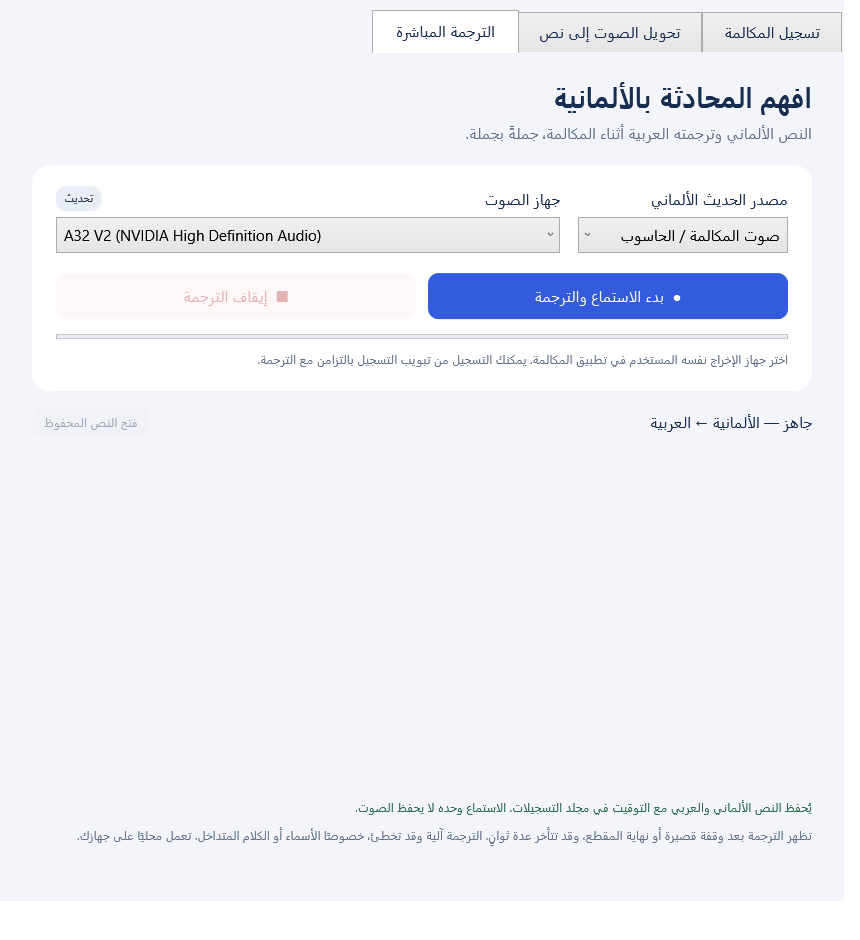

# صوت — Sout Call Recorder

برنامج لويندوز بواجهة عربية لتسجيل المكالمات وتحويل الصوت إلى نص، مع ترجمة نصية مباشرة من الألمانية إلى العربية.

## التنزيل والتشغيل

من قسم **Releases** افتح الإصدار **v1.2.0** ونزّل `Sout-CallRecorder-v1.2-Windows-x64.zip`. فك الضغط ثم افتح `CallRecorder.exe`.

يحتوي البرنامج على بيئة .NET ومكتبات التشغيل ونموذج الترجمة. لا يحتاج إلى Python أو مفتاح API. عند أول استخدام للتعرف على الكلام، ينزّل نموذج Whisper بحجم يقارب 574 ميغابايت. بعد ذلك يعمل محليًا دون اتصال، ولا يرفع الصوت أو النصوص إلى خدمة خارجية.

المتطلبات لميزات التعرف والترجمة: **Windows 11 x64**، معالج يدعم **AVX2/FMA**، و**Microsoft Visual C++ Redistributable 2022 x64**. يستخدم التعرف كرت الشاشة عبر Vulkan عند توفره، وإلا يستخدم المعالج؛ تختلف السرعة حسب الجهاز.

## المزايا

- تسجيل الميكروفون وصوت الحاسوب في ملف WAV واحد، مع اختيار الأجهزة وضبط مستوى كل مصدر.
- تحويل تسجيل كامل إلى نص بالعربية أو الألمانية أو الإنجليزية، أو باكتشاف اللغة تلقائيًا.
- حفظ التفريغ بصيغتي TXT وSRT، مع إمكانية تحويل ملفات صوتية سابقة.
- عرض الكلام الألماني وترجمته العربية أثناء المحادثة، مقطعًا بمقطع، مع حفظ سجل باللغتين والتوقيت.
- تشغيل التسجيل والترجمة المباشرة بالتزامن.
- إيقاف يدوي، ومؤشرات للصوت، وحفظ التسجيل عند إغلاق النافذة.

## تسجيل مكالمة

1. افتح تبويب **تسجيل المكالمة**.
2. اختر الميكروفون وجهاز الإخراج المستخدمين في تطبيق المكالمة.
3. اضغط **بدء التسجيل**، ثم **إيقاف وحفظ** عند الانتهاء.

المجلد الافتراضي هو `Call Recordings` داخل المستندات، ويمكن تغييره من الواجهة. الملف WAV أحادي، 16 بت، 48 كيلوهرتز، بحجم تقريبي 5.76 ميغابايت للدقيقة.

مصدر الحاسوب يلتقط **جميع الأصوات** التي تعمل على جهاز الإخراج المحدد، بما فيها التنبيهات والموسيقى. لا يعزل تطبيق مكالمات بعينه. استخدم سماعة رأس لتقليل الصدى.

## الترجمة أثناء محادثة ألمانية

1. افتح **الترجمة المباشرة**.
2. اختر **صوت المكالمة / الحاسوب**، ثم السماعة نفسها المستخدمة في تطبيق المكالمة. يمكن اختيار الميكروفون بدلًا منه.
3. اضغط **بدء الاستماع والترجمة** وانتظر حالة **الاستماع يعمل**.
4. يظهر النص الألماني ثم ترجمته العربية بعد كل مقطع كلام.
5. اضغط **إيقاف الترجمة** لإكمال المقاطع المتبقية وحفظ النص، أو **إلغاء الانتظار** لإلغاء الإكمال.

الاستماع المباشر وحده لا يحفظ الصوت. ابدأ التسجيل من تبويب التسجيل إذا أردت حفظ الصوت أيضًا. يُحفظ النص الألماني والعربي مع التوقيت في مجلد التسجيلات.

الترجمة نصية، وليست صوتًا منطوقًا. تظهر بعد وقفة قصيرة أو بعد مقطع متصل لا يتجاوز نحو ثماني ثوانٍ، وقد تتأخر عدة ثوانٍ حسب الجملة والجهاز. قد يخطئ التعرف أو الترجمة في الأسماء والأرقام واللهجات والكلام المتداخل؛ راجع النص قبل الاعتماد عليه.

## تحويل تسجيل إلى نص

فعّل **تحويل التسجيل إلى نص تلقائيًا بعد الإيقاف**، أو افتح **تحويل الصوت إلى نص** واختر ملفًا صوتيًا سابقًا. يُحفظ TXT وSRT بجانب الملف الأصلي دون تغييره أو الكتابة فوق تفريغ سابق.

إذا كانت الترجمة المباشرة تعمل عند انتهاء التسجيل، يُحفظ الصوت وتبقى الترجمة مستمرة. أوقف الترجمة ثم استخدم **تحويل آخر تسجيل** عند الحاجة إلى تفريغ كامل.

## الحفظ وحالات الإيقاف

- الإعدادات والنماذج في `%LOCALAPPDATA%/SoutCallRecorder/`.
- يتطلب بدء التسجيل 100 ميغابايت متاحة، ويتوقف عند انخفاض المساحة إلى 20 ميغابايت أو بعد عشر ساعات لتجنب حد حجم WAV.
- فصل جهاز الصوت يوقف العملية المتأثرة ويحفظ الجزء المتاح. أعد توصيل الجهاز ثم حدّث قائمة الأجهزة.
- عند تغيير السماعة، أوقف الاستماع أو التسجيل واختر الجهاز الجديد.
- إلغاء تفريغ ملف يحتفظ بالنص المستخرج، إن وجد، في ملفات تنتهي بـ `.partial.txt` و`.partial.srt`.
- إغلاق النافذة يوقف الاستماع ويلغي المعالجة المتبقية ويحفظ النص المتاح والتسجيل إذا كان يعمل.

إذا لم يظهر صوت الميكروفون، تحقق من اختيار الجهاز ومن إعداد ويندوز الذي يسمح لتطبيقات سطح المكتب بالوصول إلى الميكروفون. إذا لم يظهر صوت الطرف الآخر، طابق جهاز الإخراج بين البرنامج وتطبيق المكالمة.

## المصدر والبناء

الشيفرة في `src/`، وفحوص التشغيل في `checks/`. تعليمات البناء وتجهيز نموذج الترجمة في [BUILDING.md](BUILDING.md).

ملفات EXE والنماذج الكبيرة متاحة كأصول إصدار في **Releases**. التسجيلات وملفات الصوت والتفريغات وإعدادات الأجهزة وبيانات الاختبار المحلية مستبعدة من Git.

تم اختبار التقاط WASAPI الفعلي والتعرف على عينة ألمانية وترجمتها، بالتزامن مع تسجيل الصوت. شملت الفحوص أيضًا الصمت وحد طول المقاطع والإلغاء وفصل الجهاز. هذه الاختبارات لا تضمن الدقة أو الأداء في جميع المحادثات والأجهزة.

## المكونات والتراخيص

يستخدم البرنامج NAudio وWhisper.net وwhisper.cpp وONNX Runtime وMicrosoft.ML.Tokenizers. نموذج التعرف Whisper large-v3-turbo Q5، ونموذج الترجمة مشتق من Helsinki-NLP/opus-mt-de-ar بعد تصديره إلى ONNX وتكميمه إلى INT8.

راجع [إشعارات الأطراف الثالثة](THIRD_PARTY_NOTICES.md) ومجلد [التراخيص](licenses/). مصدر نموذج الترجمة مرخّص بـ Apache 2.0 وترد تفاصيل التعديل والهاش في الملفات المرفقة.
